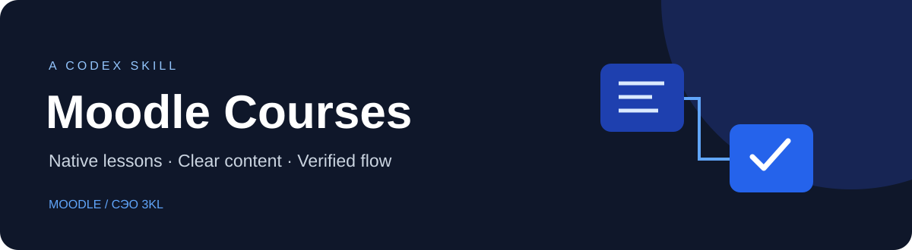

<p align="center"></p>

<p align="center">
  <a href="LICENSE"></a>
  
  
</p>

# Moodle Courses

Навык для Codex: перенос учебных материалов в Moodle и СЭО 3KL, оформление HTML и создание настоящих **«Лекций»** со встроенными вопросами.

Помогает сохранять структуру исходника и проверять результат: содержание, варианты ответов, баллы, кнопки «Далее» и завершение лекций.

## Что умеет

- Различать элементы **«Лекция»**, **«Страница»** и **«Тест»**, выбирать структуру по запросу пользователя или образцу курса.
- Переносить темы и подтемы из Word в информационные страницы внутри лекции.
- Использовать выделение правильных ответов в исходнике и таблицы соответствий.
- Импортировать вопросы Moodle XML: один ответ, несколько ответов, соответствие.
- Оформлять текст HTML и подготавливать изображения для браузера.
- Сверять ключи, баллы и переходы через развёрнутое представление Moodle.
- Исправлять только нумерацию, сохраняя порядок, содержание и границы лекций.

## Установка

Скопируйте содержимое папки [`skill/`](skill/) в каталог личных навыков Codex:

```text
~/.codex/skills/moodle-courses/
├── SKILL.md
├── agents/
│   └── openai.yaml
└── references/
    ├── lesson-workflow.md
    └── audit.md
```

На Windows типичный путь: `%USERPROFILE%\.codex\skills\moodle-courses\`.

После добавления откройте новый чат Codex, чтобы навык стал доступен для обнаружения. Для работы понадобится инструмент управления браузером и доступ к нужному курсу Moodle; навык сам по себе не подключается к сайту.

## Примеры запросов

```text
Используй $moodle-courses. Перенеси лекции и вопросы из этих файлов
в открытый курс Moodle. За образец возьми указанный курс.
```

```text
Используй $moodle-courses. Проверь каждый вопрос, все кнопки «Далее»,
баллы и завершение лекций. Отдельно укажи, что проверено в предпросмотре.
```

```text
Используй $moodle-courses. Исправь только нумерацию тем и подтем,
включая заголовки внутри текста. Ничего не объединяй и не переставляй.
```

## Как устроена работа

**Исходник → карта структуры → элементы «Лекция» → теория и вопросы → проверка.**

Сначала агент изучает исходные разделы, темы, вопросы и ключи. Затем выбирает нужные элементы Moodle, переносит материалы и проверяет опубликованный результат. Для каждой страницы и каждого вопроса ведёт локальный список ожидаемых значений и результатов проверки.

Технические подробности находятся в двух небольших справочниках:

- [Создание лекций и импорт вопросов](skill/references/lesson-workflow.md)
- [Проверка курса и нумерации](skill/references/audit.md)

## Важные границы

- Это инструкции для агента, а не автономный плагин Moodle и не серверный импортёр.
- Интерфейс зависит от версии Moodle, темы оформления и прав пользователя. Наблюдения проверены на Moodle 4.5 / СЭО 3KL; другие конфигурации могут отличаться.
- Отсутствующие ключи ответов не придумываются. Такие вопросы отмечаются отдельно.
- Совпадение с ключом исходника не означает независимую предметную экспертизу правильности самого ключа.
- Предпросмотр преподавателя не доказывает запись итоговой оценки студенту. Полная проверка оценивания должна явно учитывать это ограничение.
- Навык не даёт дополнительных прав и не разрешает менять чужие оценки, публиковать материалы или удалять элементы вне запроса пользователя.
- Учётные данные, сеансовые ключи и данные студентов не входят в навык.

## Проверка навыка

Формат `SKILL.md` проверен стандартным валидатором навыков Codex. Материалы основаны на реальном опыте работы через интерфейс Moodle. Универсальная совместимость со всеми установками Moodle не заявляется.

## Лицензия

[MIT](LICENSE). Лицензия распространяется на содержимое этого репозитория; права на Moodle и импортируемые учебные материалы принадлежат их правообладателям.
